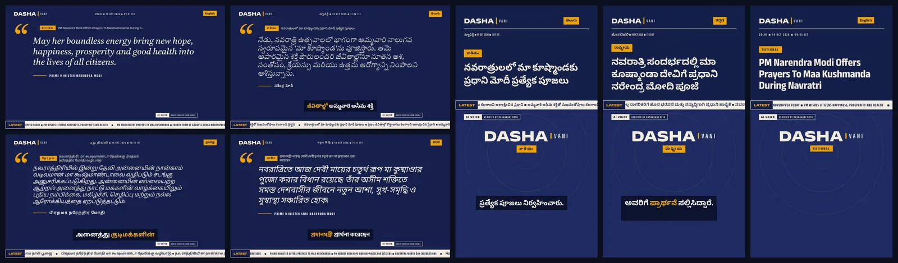
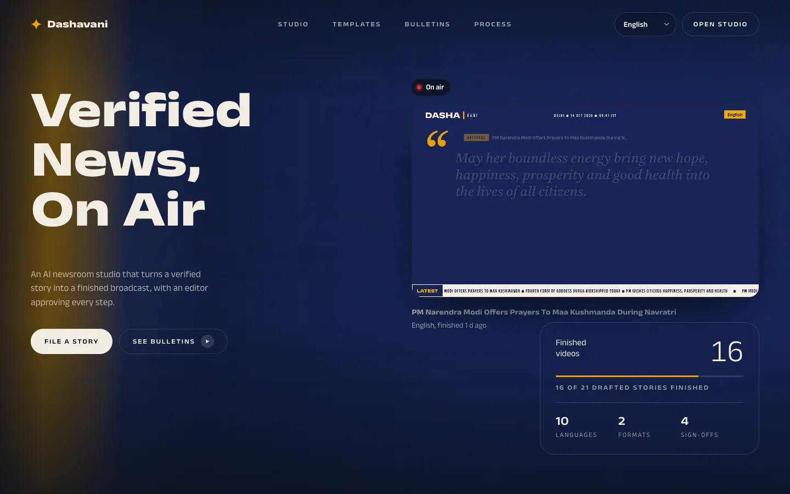
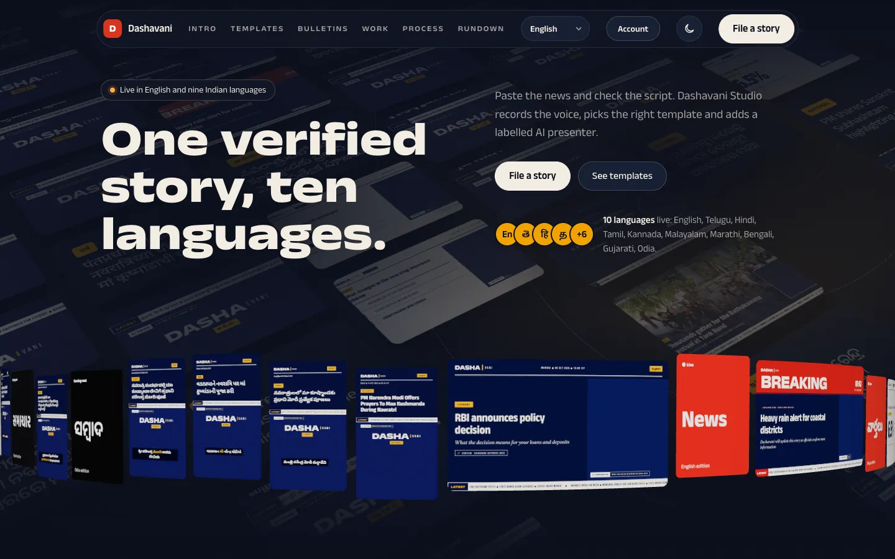
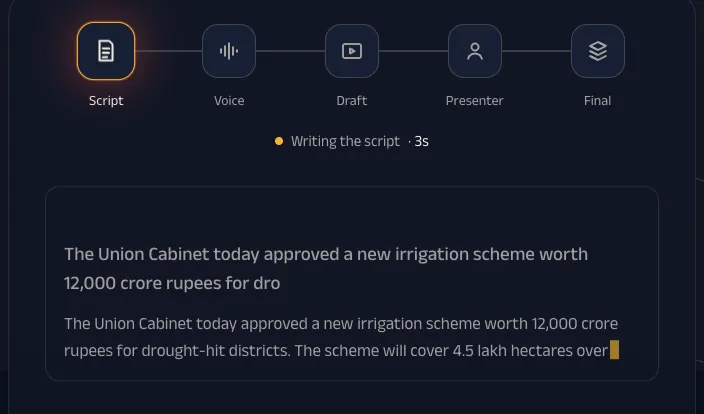
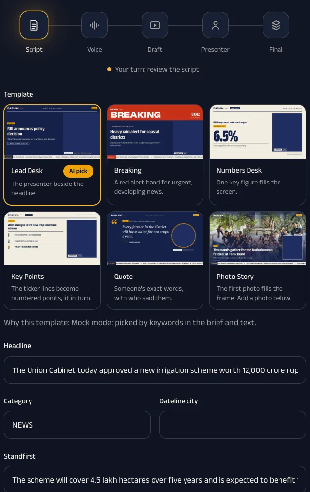
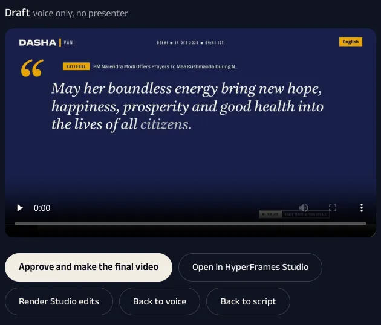
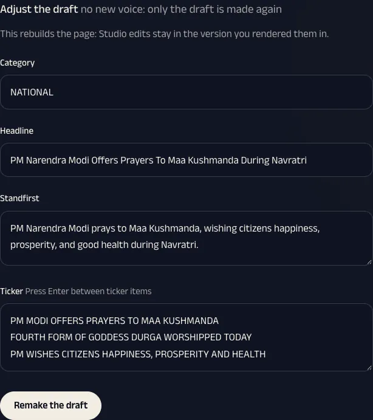
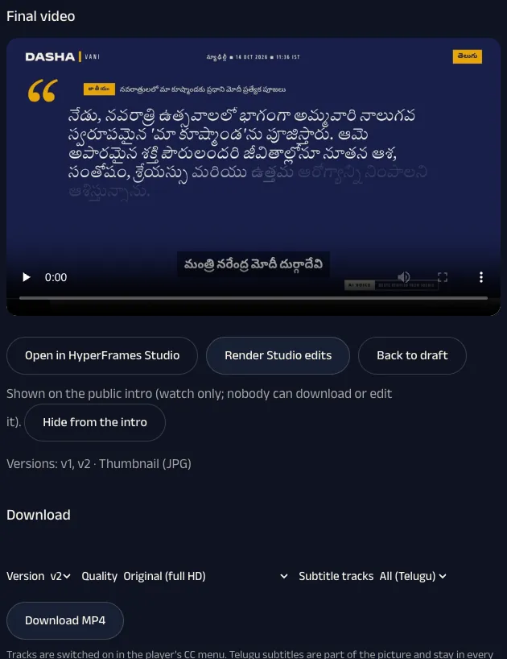

# Dashavani Studio



*One verified story, finished in several languages and both shapes. Every frame above is from a video the studio made.*

Paste a verified news item → the AI writes a broadcast script → you approve it → a voice is recorded → a branded Dashavani video is drafted → you approve → an AI presenter is added → final video. Drafts can be adjusted by hand in the app (on-screen text, when each photo or clip shows), and on the computer running the studio its owner can open any video in **HyperFrames Studio**.

Click any finished step in the progress rail (Script, Voice, Draft) to go back to it, and the AI picks the video template (Lead Desk, Breaking, Numbers Desk, Key Points or Quote; Photo Story is the editor's pick) from the news and an optional brief. Tick one or more languages when you file a story (English, Telugu, Hindi, Tamil, Kannada, Malayalam, Marathi, Bengali, Gujarati, Odia): each language becomes its own linked story with its own script, approval and video. Tick Landscape 16:9, Shorts & Reels 9:16 or both: with both, the Shorts & Reels version is made from the landscape script once you approve it. Any story with a draft also has a "Make Shorts & Reels version" (or landscape) button. The other version reuses the approved script, voice, presenter video, photos and subtitle translations (all cached), so only its layout is rendered and it adds no voice or HeyGen cost; vertical stories use the VT-05 Shorts layout. Choose AI presenter or Voice only when you file a story or at script review. The AI presenter is the HeyGen avatar set by `HEYGEN_AVATAR_ID`; the final video sends the ElevenLabs voice to HeyGen (`POST /v3/videos`, `type: "avatar"`), which returns the avatar lip-synced to it on the studio panel blue. Choose Voice only to skip the HeyGen presenter (and its cost). In landscape the presenter panel is removed and the story text takes its width; in Shorts & Reels the story photos or a Dashavani title card fill that space. Shorts & Reels can have its own choice: when you file with both formats ticked, and on the *Make Shorts & Reels version* button. Every video has subtitles timed word by word to the ElevenLabs voice. At script review, tick the subtitle languages (any of the ten) and pick which one, if any, is shown on the video. Every ticked language becomes a selectable subtitle track inside the MP4 (the CC menu in VLC, QuickTime and phone players), a track on the in-app player, and an SRT file to upload to YouTube. Other languages than the spoken one are translated by Gemini sentence by sentence, each line shown while its sentence is spoken, and listed on the draft for checking. Reels and Shorts cannot switch tracks, so they show only the language burned into the video. A voice is recorded once per exact text and voice, so going back and approving the same script again costs nothing.


## A look inside

<table>
<tr>
<td width="50%"></td>
<td width="50%"></td>
</tr>
<tr>
<td><b>Intro.</b> The public front page, showing the finished videos you choose.</td>
<td><b>Studio.</b> File a story from the verified PIB wire or paste your own.</td>
</tr>
<tr>
<td></td>
<td></td>
</tr>
<tr>
<td><b>Script, live.</b> The script appears as the AI writes it.</td>
<td><b>Script review.</b> Pick the template and check every field; numbers missing from the source are flagged.</td>
</tr>
<tr>
<td></td>
<td></td>
</tr>
<tr>
<td><b>Draft.</b> Watch it, then approve it or go back a step.</td>
<td><b>Adjust the draft.</b> Change on-screen text and when photos appear, with no new voice.</td>
</tr>
<tr>
<td></td>
<td></td>
</tr>
<tr>
<td><b>Final.</b> Download any version, size and subtitle tracks, or upload to YouTube.</td>
<td></td>
</tr>
</table>

---

## 1. Install once

| You need | How to get it | Check |
|---|---|---|
| **Node.js 22 or newer** | https://nodejs.org (LTS) | `node -v` shows v22 or higher |
| **FFmpeg** (includes ffprobe) | macOS: `brew install ffmpeg` · Windows: `winget install Gyan.FFmpeg` · Linux: `sudo apt install ffmpeg` | `ffmpeg -version` |
| Internet connection | For packages, the render browser, and the APIs | |
| ~2 GB free disk, 8 GB+ RAM | Renders use a headless browser | |

Windows: open a new terminal after installing FFmpeg so it is on the PATH.

## 2. Set up the project

Get the code (or download the ZIP from GitHub and unzip it):

```bash
git clone https://github.com/SHAYANKOURI9/DASHAVAANI-STUDIO.git
cd DASHAVAANI-STUDIO
```

Then, in that folder (this also installs the web frontend in `web/` and HyperFrames, the video engine):

```bash
npm install
```

```bash
npx hyperframes browser ensure
```

(Downloads the fixed Chrome build HyperFrames renders with, ~200 MB, once per machine.)

```bash
npx hyperframes doctor
```

(Optional check. "Docker", "whisper-cpp" and "MusicGen" warnings are fine; they are not used.)

## 3. Run it

**Demo mode, no API keys needed.** Uses a placeholder script, a silent voice and a placeholder presenter. Good for showing the flow:

```bash
npm run mock
```

**Real mode** (Gemini, ElevenLabs and HeyGen):

1. Copy `.env.example` to `.env.local` and fill in the keys (see section 4).
2. Run:

```bash
npm start
```

Then open **http://localhost:4000** and **sign up: the first account on a new copy becomes its owner** (the owner approves everyone after). Stop the server with **Ctrl+C**. Both commands build the frontend first (a few seconds).

**Working on the page itself:** keep `npm run mock` running, and in a second terminal run `npm run dev:web`, then open **http://localhost:5173**. Page edits reload instantly; API calls go through to the server on port 4000.

## 4. API keys (real mode only)

Put these in `.env.local`. Never commit or send this file. Every account's videos use them; they never appear in the app, and nobody can paste a key into it.

Keep it readable only by you: `chmod 600 .env.local` (the server warns at start if it isn't).

**Accounts.** Every page except the intro needs an account. The first person to sign up (at `/signup`) becomes the owner; anyone after that waits until the owner approves them under **Account** in the top bar. Every account's videos use the keys in `.env.local`, so you pay for all of them: editors may file 20 stories a day (`DAILY_STORIES`), and `MONTHLY_CAP_INR` stops everyone once the month's spending reaches it. Only the owner can upload to YouTube. Forgot a password? **Forgot password?** on the sign-in page emails a one-time link (valid for an hour) to set a new one; the new password signs out every older sign-in. The email is sent from your own mail account: fill in the `SMTP_*` lines in `.env.local` (see `.env.example`; for Gmail, an App Password). Until then the link is printed in the server's terminal.

| Key | Where to get it | Used for |
|---|---|---|
| `GEMINI_API_KEY` | https://aistudio.google.com/app/apikey | Writing the script, choosing the template |
| `ELEVENLABS_API_KEY` | https://elevenlabs.io/app/settings/api-keys (needs text-to-speech and voices access) | English / Telugu voice |
| `HEYGEN_API_KEY` | https://app.heygen.com/developers | The AI presenter |
| `HEYGEN_AVATAR_ID` | Your avatar's id in HeyGen | Which avatar presents |
| `SESSION_SECRET` (optional) | Any long random text | Signs sign-ins. Made for you in `data/session-secret` when unset; changing it signs everyone out |
| `YOUTUBE_CLIENT_ID`, `YOUTUBE_CLIENT_SECRET`, `YOUTUBE_REFRESH_TOKEN` (optional) | Google Cloud console: enable YouTube Data API v3, create an OAuth client of type "Desktop app"; then run `npm run youtube:auth` once and paste the line it prints | Upload to YouTube |

Optional: `GEMINI_MODEL` (default `gemini-flash-latest`; the pro models need a paid Gemini plan) and `GEMINI_FALLBACK_MODEL` (default `gemini-flash-lite-latest`, used when the main model is busy or does not answer within 90 seconds; a story only stops after six tries), `ELEVENLABS_MODEL` (default `eleven_v3`, the one that speaks Telugu), and `ELEVENLABS_VOICE_EN` / `ELEVENLABS_VOICE_TE` to pick other voices. The defaults are ElevenLabs' built-in male voices Daniel (English) and Brian (Telugu), which the free plan allows. On a paid ElevenLabs plan, switch to the Indian voices: Arjun English `hEVeuEwuN5rfDgwQ85v8` and Arjun Telugu `614hXxJLzZgeC6BDovkb`. The ElevenLabs free plan does not allow commercial use, so upgrade before publishing. The Rundown shows the voice characters left this month: ElevenLabs' own numbers if the key has the "User: Read" permission, otherwise what this app has sent, against `ELEVENLABS_MONTHLY_CHARS` (default 10000). Each story shows what it used (Gemini tokens, ElevenLabs characters, HeyGen seconds) and its cost in rupees, and the Rundown shows this month's spend by service. The rupee figures use estimated paid-plan rates (`GEMINI_INR_PER_1M_INPUT_TOKENS`, `GEMINI_INR_PER_1M_OUTPUT_TOKENS`, `ELEVENLABS_INR_PER_1K_CHARS`, `HEYGEN_INR_PER_MINUTE`); set your plan's real rates in `.env.local`. Cached voices and presenters add nothing.

Money is spent only when you **approve the draft** (HeyGen) and, much less, when scripts and voices are made. Drafts, Studio edits and re-renders are free. The same voice and avatar never pay HeyGen twice.

## 4b. Put it online (any computer or phone)

1. Install the tunnel once: `brew install cloudflared`.
2. Start the studio as usual (`npm start`), then in a second terminal: `npm run online`.
3. It prints an address like `https://calm-river-12.trycloudflare.com`. Anyone can open it from anywhere; it is HTTPS.
4. Share that address. The studio is online while this Mac is on and both commands run (`npm run online` keeps the Mac awake). Press Ctrl+C to take it offline.

The quick-tunnel address changes every time you start it. For a fixed address on your own domain, use a named Cloudflare tunnel and set `PUBLIC_HOST=studio.example.com` and `PUBLIC_URL=https://studio.example.com` in `.env.local`. Online, sign-in cookies are HTTPS-only, sign-in/sign-up/reset are limited to 20 tries per 15 minutes per connection, and **Edit in Studio** works only for the owner on this Mac.

## 4b2. Showcase page on Vercel (free, always online)

The studio itself can't run on Vercel (renders take minutes and need ffmpeg, Chrome and the `data/` folder), so
`showcase/` is a plain static page about it: the hero image, three finished videos (under 3 MB together), the steps and
screenshots. It works even when your Mac is off.

1. On vercel.com: **Add New → Project**, import `dashavani-studio`.
2. **Root Directory:** `showcase`. **Application Preset:** Other. No build command. **Deploy.**
3. Every merge to `main` updates it. To show an **Open the live studio** button, put your studio's fixed address
   (your tunnel) in `showcase/config.js`.

## 4c. Backup and restore

`data/` is the only copy of your accounts, stories and videos, and it isn't in git. `npm run backup` zips it to
`../dashavani-backups/dashavani-data-<date>.zip`, readable only by you (it holds the accounts file and the server secret).

To restore: stop the server, move the current `data/` aside, then `unzip ../dashavani-backups/<file>.zip` in this
folder and `npm start`. Sign-ins keep working because the zip includes `data/session-secret`
(if you set `SESSION_SECRET` in `.env.local` instead, keep the same value).

## 5. Using it

0. **Pick a verified story** from the *Verified inbox* (latest Press Information Bureau releases), or paste one yourself. *Use this story* loads the release in your chosen language when PIB published it in that language, and the story keeps a link to the original.
1. **File a story.** Paste the news, optionally add a brief ("make it breaking", "focus on the rate"), and pick one or more languages.
2. **Script review.** Check every field. Switch the template if you like. Red warnings mean a number in the script isn't in your source text.
3. **Draft.** Listen to the voice, watch the draft, then **Approve**, adjust it, or go back to the voice or the script.
   - **Adjust the draft** (anyone, from any device): change the category, headline, standfirst and ticker, and for each photo or clip set when it starts or leave it out. **Remake the draft** redraws it with the same voice, so it costs nothing.
   - **Ask for a change** in plain words for anything else ("use the Breaking template", "make it voice only").
   - Back at **Voice**, change the narration and **Record the voice again**, or **Keep this voice and make the draft**.
4. **Final.** **Re-render** makes v2, v3 and so on. **← Back to draft** is also available.

### HyperFrames Studio (hand editing, on the studio's own computer)

For frame-by-frame editing (layout, timing, animation), open the video's project in HyperFrames Studio. It is
installed with `npm install`, free (open source, Apache-2.0) and needs no account.

1. On a draft, press **Open in HyperFrames Studio**. Or open it yourself:
   `npx hyperframes preview data/projects/<story id>` (then http://localhost:3002).
2. Edit and save in Studio.
3. Back in the studio, press **Render Studio edits**. It makes a new draft from your edited page, listed under
   **Versions** as "Studio edits". (On a finished video, **Render Studio edits** makes the next final.)

**Your edits are kept with their version.** Every draft keeps a copy of the page it was rendered from. Asking for a
change in words, adjusting the draft or going back to the voice or script starts again from the script, not from your
Studio edits; your edits stay in the version you rendered them in, and **Use this version** on it brings them back.

- **Who sees the Studio buttons:** the owner, using the studio at `localhost` on the computer it runs on. Anyone who
  clones this repo and runs it is the owner of their own copy, so it works for them there.
- **Why not online:** Studio is a local editing tool. It writes the project's files directly and has no sign-in of its
  own, so it runs on that computer only (port 3002) and is never reachable through `npm run online`. People using the
  studio online adjust drafts in the app instead (above), where every change goes through their sign-in.

Add `?still` to the URL to turn off 3D motion, for slow machines or screenshots.

## 6. Troubleshooting

| Problem | Fix |
|---|---|
| `EADDRINUSE … 4000` | An old server is still running. Stop it with Ctrl+C in its terminal, or run on another port: `PORT=4100 npm run mock` (Windows PowerShell: `$env:PORT=4100; npm run mock`) |
| A button says "Not found" | The server is older than the page. Restart the server. (`npm run mock` restarts itself on code changes; `npm start` does not.) |
| Edit in Studio opens in the same tab | Your browser blocked the pop-up. Allow pop-ups for `localhost`, or use Back to return. |
| Render fails or is very slow | Close other apps (it needs memory), run `npx hyperframes doctor`, then **Retry this step**. |
| "… is not set in .env.local" | Add that key to `.env.local` and restart `npm start`. |

## 7. Project layout

```
server.mjs          web server and job API (jobs saved in data/jobs/*.json)
pipeline.mjs        the steps: script → voice → template → draft → avatar → final
web/                frontend: Vite + React + TypeScript + Tailwind v4 + shadcn
  index.html        the page
  src/app.js        page logic (filing, review, back steps); plain DOM
  src/wall.js       hero background wall; drop your own pictures in src/wall/
  src/press.js      the 3D scenes (three.js)
  src/finished.tsx  "Finished videos" disc carousel (React)
  src/components/ui shadcn components, incl. disc-cascade-carousel.tsx
public/templates/   template preview images
sources.mjs         verified story sources (PIB today). Add PTI or another agency here as one entry once its feed, credentials and licence exist
templates/          HyperFrames video templates: vt01-lead-desk, vt03-breaking, vt04-numbers-desk
data/               created at runtime: jobs, per-video projects, renders, avatar cache
tasks/              plan and task list
```

**Making changes.** `main` always works and is never committed to directly. Each change gets its own short-lived
branch named for what it does (`feature/…`, `fix/…`, `docs/…`, `ci/…`), goes to GitHub as a pull request, and is
merged only once the **Tests** check (`.github/workflows/test.yml`: `npm test` and `npm run build`) passes. The branch
is deleted after the merge.

Tests: `npm test`. Add shadcn components from `web/` with `npx shadcn@latest add <name>`; they land in `web/src/components/ui`, which the `@/components/ui/...` imports rely on.

## What else the app does

- **Script checks:** scripts in the Indian languages come with a literal English rendering to check meaning; approval needs a tick that every line was checked.
- **Quality check:** after each draft, Gemini looks at three frames for cut-off or overlapping text, broken letters, badly fitted photos or blank frames. Problems, numbers not in the source and translated subtitles mark a story **Needs review** (a filter in the rundown).
- **Ask for a change:** on a draft, say the change in plain words ("make the headline shorter", "use the Breaking template"); each draft is kept as a version with its cost, and any version can be brought back.
- **Clips and the timeline:** stories take video clips as well as photos; cutaways start at pauses in the voice; the story page shows the draft as a timeline with a reason for each cut.
- **Intro, end card and music:** every video opens with a Dashavani sting, closes with an end card and an AI disclosure, and has a generated music bed under it (a tick box turns them off).
- **Bulletins:** on the Bulletins tab, tick several stories in order to join them into one video.
- **Languages:** English, Telugu, Hindi, Tamil, Kannada, Malayalam, Marathi, Bengali, Gujarati and Odia. Each Indian script has its Noto Sans font in every template. The voice defaults to ElevenLabs' multilingual Brian; set `ELEVENLABS_VOICE_<CODE>` (for example `ELEVENLABS_VOICE_TA`) for a native voice per language. PIB stories open in the chosen language when PIB published that version.
- **Download and subtitles after the final:** pick a version, a size (original full HD, 720p or 480p) and which subtitle tracks go in the file (all, one language or none); smaller files are made once and kept. Subtitles shown on the picture are part of the image; to change them, use **Subtitles** on the finished story, which makes a new final (the presenter is reused, so only new translations cost anything).
- **Interface language:** the menu in the top bar switches the whole studio and the intro page between English and the nine Indian languages (remembered in the browser). Stories themselves are never translated. The translations live in `web/src/i18n/<code>.json`, one line per interface text; correct any line by hand. After changing interface text, run `npm run i18n`: it collects the lines again and has Gemini translate only the new ones (a few rupees), keeping your corrections. In the code, interface text goes through `t("…")` with `{placeholders}` for values.
- **Intro page:** opening the studio address (`localhost:4000`) shows `/intro` first, once each time the server starts; **Open studio** then goes to the studio, and links to a story (`?job=…`) open it directly. **Intro** in the top bar brings it back. `/intro` is a cinematic front page for the studio. Scrolling plays `web/public/intro/film.mp4` forward and back, with four lines of text along the way; `poster.jpg` shows until the film loads (and always with reduced motion). To change the film, join two clips that share their seam frame and keep a keyframe every few frames so scrolling stays smooth: `ffmpeg -i a.mp4 -i b.mp4 -filter_complex "[0:v][1:v]concat=n=2:v=1,scale=1280:-2[v]" -map "[v]" -an -c:v libx264 -g 6 -crf 26 -movflags +faststart web/public/intro/film.mp4`, then `npm run build`.
- **Publishing:** a finished story gets a publish pack (YouTube title, description with the AI disclosure and source link, tags, hashtags, Instagram caption, X post) with Copy buttons, and a full-size thumbnail to download. **Upload to YouTube** sends the final, its thumbnail and every subtitle track as a **private** video, or scheduled to go public at a time you pick. YouTube allows about 10,000 API units a day; one upload with captions uses about 2,000, so roughly five uploads a day. Custom thumbnails need a verified channel.
- **Design a new look:** describe a style change to a template; it passes a brand check (the house colours only, nothing loaded from outside, the AI label stays visible) and arrives as a draft with a preview to approve.


## License and policies

MIT, see [LICENSE](LICENSE). Taking part in this project means following the [Code of Conduct](CODE_OF_CONDUCT.md). Found a security problem? Report it privately as described in [SECURITY.md](SECURITY.md), not in a public issue.
